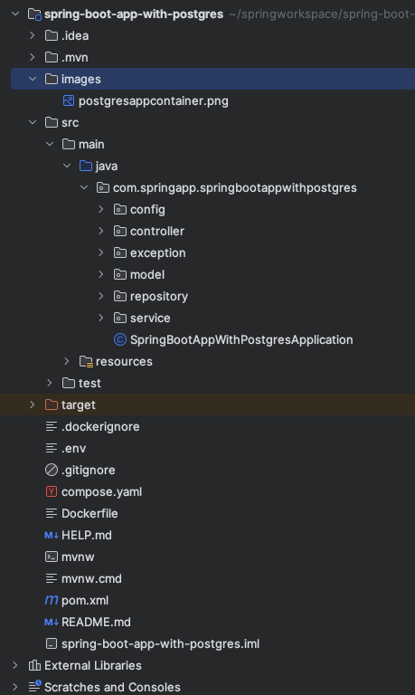
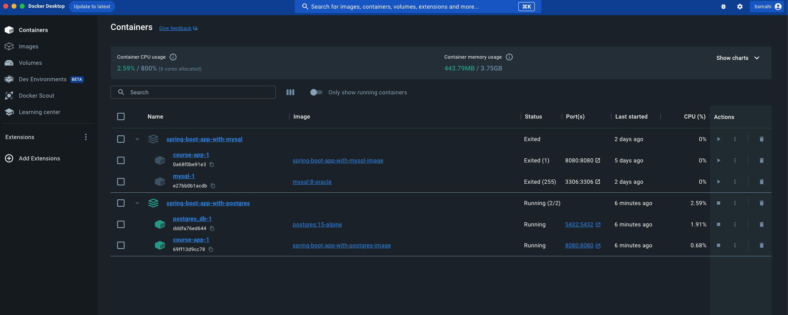
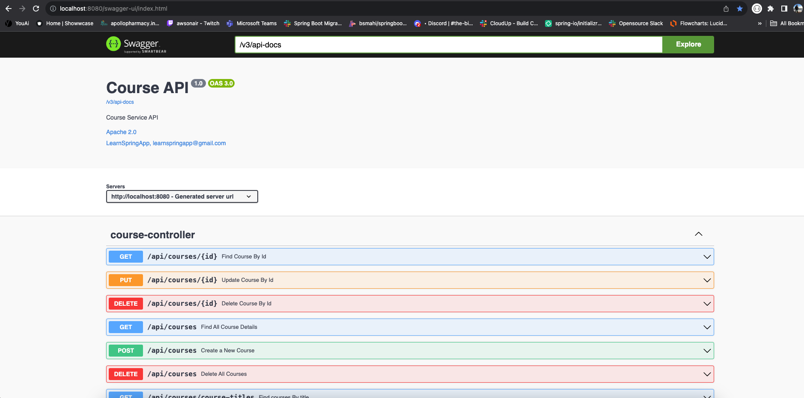
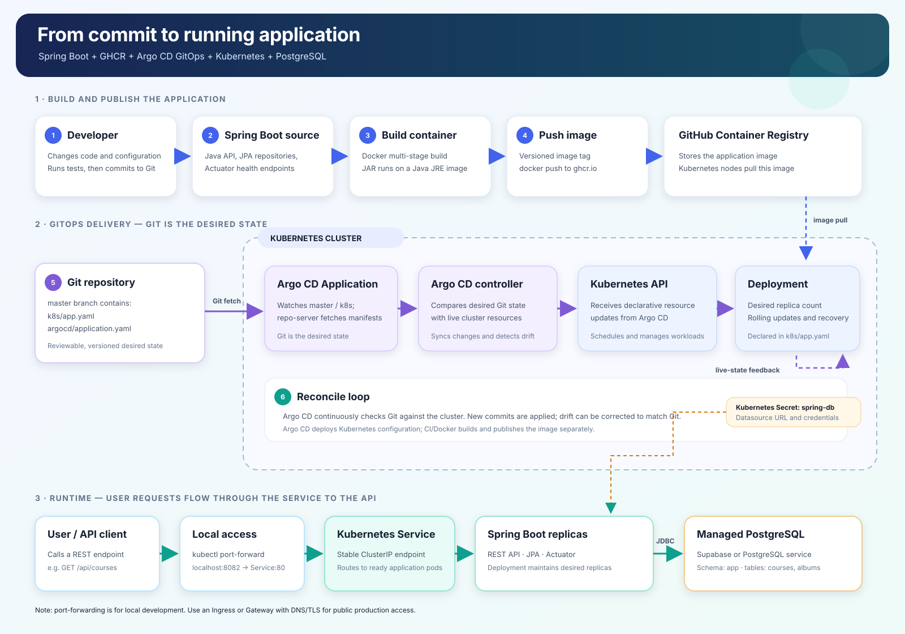

# Spring Boot Rest API with PostgreSQL

We will build a Spring Boot JPA REST API for courses and album information:

- Courses have an id, title, description, and published status, with CRUD operations and title search.
- Album records have an id, name, description, price, and automatically managed creation/update timestamps.

## Technologies Used

- Java 25 (build and runtime)
- Spring Boot 4.1.1
- Maven 3.9.11 (Docker image)
- Spring Modules Covered: Spring Boot Web, Spring Data Jpa, Spring Actuator, OpenAPI
- Database: PostgreSQL (Supabase for the local profile; local PostgreSQL is also available with Docker Compose)
- Build Tool: Maven

The Docker build uses Maven 3.9.11 and Eclipse Temurin 25 to compile the application; the runtime image contains the Java 25 JRE. Spring Boot 4.1.1 is configured as the project parent in `pom.xml`.

The application provides REST endpoints for courses and albums, backed by PostgreSQL through Spring Data JPA.

- Course endpoints support create, retrieve, update, and delete operations, plus title search.
- Album endpoints support album creation, listing, exact-name lookup, and case-insensitive name search.

These are APIs that we need to provide:

| HTTP Method |                    Urls                    |                    Description                    |
|:-----------:|:------------------------------------------:|:-------------------------------------------------:|
|    POST     |                /api/courses                |                 Create New Course                 |
|     GET     |                /api/courses                |                Get All the Courses                |
|     GET     |              /api/courses/:id              |             Retrieve a Course by :id              |
|     PUT     |              /api/courses/:id              |              Update a Course by :id               |
|   DELETE    |              /api/courses/:id              |              Delete a Course by :id               |
|   DELETE    |                /api/courses                |              Delete All the Courses               |
|     GET     | /api/courses/courses-title?title=[keyword] | Retrieve all Courses which title contains keyword |

## Project Folder Structure



Let me explain it briefly

- `Course.java` maps to the `courses` table
- `AlbumInfo.java` maps to `album_info_details`
- `CourseRepository.java` the interface extends JpaRepository for CRUD methods and custom finder methods. It will be
  autowired in CourseController
- `CourseController.java` the class where we will define all endpoints as a presentation layer
- Configuration for Spring Datasource, JPA & Hibernate in `application.properties`
- `pom.xml` contains all the dependencies required for this application

## Create Spring Boot Project

For pre-initialized project using Spring Initializr, please
click [here](https://start.spring.io/#!type=maven-project&language=java&platformVersion=4.1.1&packaging=jar&jvmVersion=25&groupId=com.springapp&artifactId=spring-boot-app-with-postgres&name=spring-boot-app-with-postgres&description=Demo%20project%20for%20Spring%20Boot&packageName=com.springapp.spring-boot-app-with-postgres&dependencies=web,data-jpa,lombok,actuator,postgresql)

## Configure Spring Datasource, JPA, Hibernate

The datasource is PostgreSQL. The application uses the `app` schema and Hibernate updates its mapped tables on startup.

```properties
spring.datasource.url=jdbc:postgresql://<pooler-host>:5432/postgres
spring.datasource.username=postgres.<project-ref>
spring.datasource.password=<password>
spring.jpa.properties.hibernate.jdbc.lob.non_contextual_creation=true
spring.jpa.properties.hibernate.dialect=org.hibernate.dialect.PostgreSQLDialect
spring.jpa.properties.hibernate.default_schema=app
# Hibernate ddl auto (create, create-drop, validate, update)
spring.jpa.hibernate.ddl-auto=update
#Turn Statistics on
spring.jpa.properties.hibernate.generate_statistics=true
logging.level.org.hibernate.stat=debug
# Show all queries
spring.jpa.show-sql=true
spring.jpa.properties.hibernate.format_sql=true
```

## Connect to Supabase

This project uses [Supabase](https://supabase.com) as its hosted PostgreSQL provider. Supabase provides a managed PostgreSQL database and related services such as authentication, storage, and realtime capabilities. For this application, Spring Boot connects to Supabase's PostgreSQL database through the standard PostgreSQL JDBC driver, so the existing Spring Data JPA repositories and entities can continue to work with PostgreSQL.

### Benefits and when to use Supabase

- Use a hosted database without provisioning and maintaining your own PostgreSQL server.
- Connect to the same cloud database from local development, deployed applications, or multiple team environments.
- Start with PostgreSQL and add Supabase services such as authentication, storage, or realtime updates if the application needs them.
- Supabase can be a good fit for prototypes, MVPs, and applications that need a managed PostgreSQL database and want to reduce infrastructure setup.

Use local PostgreSQL instead when you need fully offline development or want to manage the database infrastructure yourself. For production, review Supabase plan limits, backups, network access, and database security requirements for your workload.

### Create a Supabase project and database

1. Sign in at [supabase.com](https://supabase.com) and create an organization if prompted.
2. Select **New project**, choose the organization, and enter a project name, a strong database password, and a region near the application.
3. Create the project and wait for its database to finish provisioning. Supabase creates a PostgreSQL database with a default `postgres` database.
4. In the project dashboard, select **Connect**. For local development on an IPv4 network, choose **Session pooler** and copy its connection details. The session pooler is suitable for this long-running Spring Boot application when a direct IPv6 connection is unavailable. Use the host, port, database name, and username exactly as shown; pooled usernames include the project reference.


```sh
export SPRING_DATASOURCE_URL='jdbc:postgresql://<pooler-host>:5432/postgres'
export SPRING_DATASOURCE_USERNAME='postgres.<project-ref>'
export SPRING_DATASOURCE_PASSWORD='<database-password>'
./mvnw spring-boot:run
```

Set these environment variables in the same shell before launching the application. Alternatively, configure the equivalent `spring.datasource.*` properties in `application-local.properties`, but keep real credentials out of source control. The `local` profile is enabled by `application.properties`.

### Create the application tables

This project stores its tables in the PostgreSQL schema `app`. In the Supabase dashboard, open **SQL Editor**, create a query, paste the contents of [`src/main/resources/schema.sql`](src/main/resources/schema.sql), and run it. To add the sample records, run [`src/main/resources/data.sql`](src/main/resources/data.sql) afterward. These scripts create the tables and sequence and can be run again safely.

The resulting table structure is shown below:

| Schema | Table | Columns |
|:---|:---|:---|
| `app` | `courses` | `id` (bigint, primary key), `title` (text), `description` (text), `published` (boolean) |
| `app` | `album_info_details` | `album_id` (bigint, primary key), `album_name` (text), `album_description` (text), `album_price` (numeric), `date_created` (timestamp), `last_updated` (timestamp) |

In Supabase, you can confirm the tables under **Table Editor** by selecting the `app` schema. For connection modes and where to find the database connection details, see [Supabase: Connect to your database](https://supabase.com/docs/guides/database/connecting-to-postgres).

## Define Course Entity

The `Course` entity maps to the `courses` table. Its primary key is generated by the database using the identity strategy.

```java
package com.springapp.springbootappwithpostgres.model;

import jakarta.persistence.*;
import lombok.AllArgsConstructor;
import lombok.Data;
import lombok.RequiredArgsConstructor;

@Entity
@Table(name = "courses")
@Data
@RequiredArgsConstructor
@AllArgsConstructor
public class Course {

    @Id
    @GeneratedValue(strategy = GenerationType.IDENTITY)
    private long id;

    @Column(name = "title")
    private String title;

    @Column(name = "description")
    private String description;

    @Column(name = "published")
    private boolean published;
}
```

- `@Entity` annotation indicates that the class is a persistent Java class
- `@Table` annotation provides the table that maps this entity
- `@Id` annotation is for the primary key
- `@GeneratedValue` annotation defines how the primary key is generated. `GenerationType.IDENTITY` uses the database identity column.
- `@Column` annotation is used to define the column in database that maps annotated field

## Define AlbumInfo Entity

`AlbumInfo` maps to the `album_info_details` table. It stores album names, descriptions, and prices. Its ID uses a database sequence; Hibernate manages the creation and update timestamps.

```java
package com.springapp.springbootappwithpostgres.model;

import jakarta.persistence.*;
import lombok.AllArgsConstructor;
import lombok.Data;
import lombok.RequiredArgsConstructor;
import org.hibernate.annotations.CreationTimestamp;
import org.hibernate.annotations.UpdateTimestamp;

import java.math.BigDecimal;
import java.time.LocalDateTime;

@Entity
@Table(name = "album_info_details")
@Data
@RequiredArgsConstructor
@AllArgsConstructor
@NamedQuery(
    name = "AlbumInfo.findByNameIgnoreCaseContaining",
    query = "select a from AlbumInfo a where LOWER(a.name) LIKE LOWER(?1)"
)
public class AlbumInfo {

    @Id
    @GeneratedValue(strategy = GenerationType.SEQUENCE)
    @Column(name = "album_id")
    private long id;

    @Column(name = "album_name")
    private String name;

    @Column(name = "album_description")
    private String description;

    @Column(name = "album_price")
    private BigDecimal price;

    @CreationTimestamp
    private LocalDateTime dateCreated;

    @UpdateTimestamp
    private LocalDateTime lastUpdated;
}
```

The album endpoints are rooted at `/api/albums`:

| HTTP Method | URL | Description |
|:-----------:|:----|:------------|
| POST | `/api/albums` | Create an album |
| GET | `/api/albums` | List albums |
| GET | `/api/albums/{name}` | Find an album by exact name |
| GET | `/api/albums/all/{names}` | Search album names, ignoring case |

Album creation accepts a JSON body with `name`, `description`, and `price`, for example:

```json
{
  "name": "Java 25 Masterclass",
  "description": "A guide to modern Java",
  "price": 49.99
}
```

## CourseRepository

Let's create a repository interface to interact with database operations

In _repository_ folder, create `CourseRepository` interface that `extends JpaRepository`

```java
package com.springapp.springbootappwithpostgres.repository;

import com.springapp.springbootappwithpostgres.model.Course;
import org.springframework.data.jpa.repository.JpaRepository;
import org.springframework.stereotype.Repository;

import java.util.List;

@Repository
public interface CourseRepository extends JpaRepository<Course, Long> {

    List<Course> findByTitleContaining(String title);

}
```

Since Spring is providing boilerplate/implementation code for the `findAll(), findById(), save(), delete()`
and `deleteById()` through `JpaRepository` interface

We can also define the custom methods:

- `findByTitleContaining()`: returns all Courses which title contains input title

## CourseController

Let's create CourseController class define the all the endpoints

```java
package com.springapp.springbootappwithpostgres.controller;

import com.springapp.springbootappwithpostgres.model.Course;
import com.springapp.springbootappwithpostgres.service.CourseService;
import io.swagger.v3.oas.annotations.Operation;
import org.springframework.http.HttpStatus;
import org.springframework.http.ResponseEntity;
import org.springframework.web.bind.annotation.*;
import org.springframework.web.servlet.support.ServletUriComponentsBuilder;

import java.util.List;
import java.util.Optional;

@CrossOrigin(origins = "http://localhost:8081") // to allow course-app frontend application
@RestController
@RequestMapping("/api/courses")
public class CourseController {

    private final CourseService service;

    public CourseController(CourseService service) {
        this.service = service;
    }

    // http://localhost:8080/api/courses/
    @GetMapping
    @Operation(summary = "Find All Course Details")
    public ResponseEntity<List<Course>> getAllCourses() {
        Optional<List<Course>> courses = service.findAll();

        return courses.map(courseDetails -> new ResponseEntity<>(courseDetails, HttpStatus.OK))
                .orElseThrow(() -> new CourseNotFoundException("No Courses are available.."));
    }

    // http://localhost:8080/api/courses/course-titles?title=boot
    @GetMapping("/course-titles")
    @Operation(summary = "Find courses By title")
    public ResponseEntity<List<Course>> getAllCoursesBasedOnTitle(@RequestParam String title) {
        Optional<List<Course>> courses = service.findByTitleContaining(title);

        return courses.map(courseDetails -> new ResponseEntity<>(courseDetails, HttpStatus.OK))
                .orElseThrow(() -> new CourseNotFoundException("No Courses are available.."));
    }

    // http://localhost:8080/api/courses/1
    @GetMapping("/{id}")
    @Operation(summary = "Find Course By Id")
    public ResponseEntity<Course> getCourseById(@PathVariable("id") long id) {
        Optional<Course> course = service.findById(id);

        return course.map(courseOne -> new ResponseEntity<>(courseOne, HttpStatus.OK))
                .orElseThrow(() -> new CourseNotFoundException("No Courses are available.."));

    }

    // http://localhost:8080/api/courses
    @PostMapping
    @Operation(summary = "Create a New Course")
    public ResponseEntity<Course> createCourse(@RequestBody Course course) {
        Optional<Course> newCourse = service.createCourse(course);
        var location = ServletUriComponentsBuilder.fromCurrentRequest()
                .path("/{id}")
                .buildAndExpand(newCourse.get().getId())
                .toUri();

        return ResponseEntity.created(location)
                .build();
    }

    @PutMapping("/{id}")
    @Operation(summary = "Update Course By Id")
    public ResponseEntity<Optional<Course>> updateCourse(@PathVariable("id") long id,
                                                         @RequestBody Course course) {
        var courseData = service.findById(id);

        if (courseData.isPresent()) {
            Course updateCourse = courseData.get();
            updateCourse.setTitle(course.getTitle());
            updateCourse.setDescription(course.getDescription());
            updateCourse.setPublished(course.isPublished());
            return new ResponseEntity<>(service.createCourse(updateCourse), HttpStatus.OK);
        } else {
            return new ResponseEntity<>(HttpStatus.NOT_FOUND);
        }
    }

    @DeleteMapping
    @Operation(summary = "Delete All Courses")
    public ResponseEntity<HttpStatus> deleteAllCourses() {
        service.deleteAllCourses();
        return new ResponseEntity<>(HttpStatus.NO_CONTENT);
    }

    @DeleteMapping("/{id}")
    @Operation(summary = "Delete Course By Id")
    public ResponseEntity<HttpStatus> deleteCourseById(@PathVariable("id") long id) {
        service.deleteCourseById(id);
        return new ResponseEntity<>(HttpStatus.NO_CONTENT);
    }

}
```

## Run & Test

Run Spring Boot application with command: `mvn spring-boot:run`

> Get All courses: http://localhost:8080/api/courses/

> Get A Single Course: http://localhost:8080/api/courses/1

> Get All course based on the title: http://localhost:8080/api/courses/course-titles?title=boot

> Create a new course: http://localhost:8080/api/courses

**Sample POST Request**

```json
{
  "title": "test title",
  "description": "testdescription",
  "published": false
}
```

> Delete All courses: http://localhost:8080/api/courses/

> Delete A Single Course: http://localhost:8080/api/courses/1

> Update A Single Course: http://localhost:8080/api/courses/1

**Sample PUT Request**

```json
{
  "title": "Updated test title",
  "description": "Updated test description",
  "published": true
}
```

## Create Docker Image for Spring Boot App

The root `Dockerfile` uses a multi-stage build: Maven and Java 25 compile the application, then a smaller Java 25 JRE image runs the executable JAR as a non-root user. Build and test locally with:

```sh
./mvnw test
docker build -t spring-boot-app-with-postgres:local .
```

The Docker build skips tests; run `./mvnw test` separately before publishing an image. The `.dockerignore` file excludes build output and local configuration from the image build context.

## Run with Docker Compose

The repository's `compose.yaml` starts the Spring Boot app and a local PostgreSQL 15 container.

Follow version 3 syntax defined by Docker:

```yaml
version: '3.8'

services:
  course-app:
  postgres_db:

```

`version`: Docker Compose file format version will be used.
`services`: individual services in isolated containers.

The Compose configuration has two services: `course-app` (Spring Boot) and `postgres_db` (PostgreSQL).

Here go with the complete docker compose file

```yaml
version: '3.8'

services:
  course-app:
    image: spring-boot-app-with-postgres-image
    build:
      context: .
      dockerfile: Dockerfile
    ports:
      - $SPRING_LOCAL_PORT:$SPRING_DOCKER_PORT
    depends_on:
      - postgres_db
    environment:
      SPRING_DATASOURCE_URL: jdbc:postgresql://postgres_db:5432/$POSTGRES_DB
      SPRING_DATASOURCE_USERNAME: $POSTGRES_USER
      SPRING_DATASOURCE_PASSWORD: $POSTGRES_PASSWORD
  postgres_db:
    image: postgres:15-alpine
    env_file: ./.env
    environment:
      POSTGRES_USER: $POSTGRES_USER
      POSTGRES_PASSWORD: $POSTGRES_PASSWORD
      POSTGRES_DB: $POSTGRES_DB
    ports:
      - $POSTGRES_DB_LOCAL_PORT:$POSTGRES_DB_DOCKER_PORT
```

## Components of Docker Compose File

- course-app:
    - `image`: final image name
    - `build`: configuration options that are applied at build time that we defined in the _Dockerfile_ with relative
      path
    - `environment`: environmental variables that Spring Boot application uses
    - `ports` : Inbound and outbound ports
    - `depends_on`: dependency order, `postgres_db` is started before app
- postgres_db:
    - `image`: postgres image pull it from docker hub registry, if it is not available in the locally
    - `env_file`: specify our .env path that we will create later
    - `environment`: Specify the environment variables
    - `ports`: Inbound and outbound ports

## Docker Compose Environment variables

In the service configuration, we utilized environmental variables specified within the `.env` file.
Now we will create it.

### _.env_

Use your own local database credentials. Do not commit `.env`.

```properties
POSTGRES_USER=postgres
POSTGRES_PASSWORD=<local-database-password>
POSTGRES_DB=postgres
POSTGRES_DB_LOCAL_PORT=5432
POSTGRES_DB_DOCKER_PORT=5432
SPRING_LOCAL_PORT=8080
SPRING_DOCKER_PORT=8080
```

Compose passes the local PostgreSQL connection to the app, overriding the Supabase datasource settings from the `local` profile. Start the services with:

```sh
docker compose up --build
```

Stop them with `docker compose down`.

The following is example output from an earlier build; image versions, IDs, and timings may differ:

```logsyaml
puneethsai@Puneeths-MacBook-Pro spring-boot-app-with-postgres % docker compose up -d
[+] Running 10/10
 ✔ postgres_db 8 layers [⣿⣿⣿⣿⣿⣿⣿⣿]      0B/0B      Pulled                                                                                                                                           58.9s 
   ✔ 96526aa774ef Already exists                                                                                                                                                                     0.0s 
   ✔ 86da063037d7 Pull complete                                                                                                                                                                      0.8s 
   ✔ a93c97be5f7f Pull complete                                                                                                                                                                      0.9s 
   ✔ 9737661d941c Pull complete                                                                                                                                                                     42.4s 
   ✔ eb9232875c66 Pull complete                                                                                                                                                                      2.1s 
   ✔ f11c93c2122d Pull complete                                                                                                                                                                      2.1s 
   ✔ be31ef1a5d20 Pull complete                                                                                                                                                                      3.7s 
   ✔ b09d59c238cc Pull complete                                                                                                                                                                      3.7s 
 ! course-app Warning                                                                                                                                                                                3.8s 
[+] Building 97.7s (10/10) FINISHED                                                                                                                                                  docker:desktop-linux
 => [course-app internal] load build definition from Dockerfile                                                                                                                                      0.1s
 => => transferring dockerfile: 174B                                                                                                                                                                 0.0s
 => [course-app internal] load .dockerignore                                                                                                                                                         0.1s
 => => transferring context: 680B                                                                                                                                                                    0.0s
 => [course-app internal] load metadata for docker.io/library/maven:3.8.5-openjdk-17                                                                                                                 4.2s
 => [course-app auth] library/maven:pull token for registry-1.docker.io                                                                                                                              0.0s
 => CACHED [course-app 1/4] FROM docker.io/library/maven:3.8.5-openjdk-17@sha256:3a9c30b3af6278a8ae0007d3a3bf00fff80ec3ed7ae4eb9bfa1772853101549b                                                    0.0s
 => [course-app internal] load build context                                                                                                                                                         0.1s
 => => transferring context: 145.84kB                                                                                                                                                                0.0s
 => [course-app 2/4] WORKDIR /spring-boot-app-with-postgres                                                                                                                                          0.1s
 => [course-app 3/4] COPY . .                                                                                                                                                                        0.1s
 => [course-app 4/4] RUN mvn clean install -DskipTests                                                                                                                                              91.0s
 => [course-app] exporting to image                                                                                                                                                                  1.9s
 => => exporting layers                                                                                                                                                                              1.9s
 => => writing image sha256:f06b7c288ffcdbd583b2fb9884f455b9c42f11f970fe95aeb9ea9cb602a2b06d                                                                                                         0.0s 
 => => naming to docker.io/library/spring-boot-app-with-postgres-image                                                                                                                               0.0s 
[+] Running 3/3                                                                                                                                                                                           
 ✔ Network spring-boot-app-with-postgres_default          Created                                                                                                                                    0.6s 
 ✔ Container spring-boot-app-with-postgres-postgres_db-1  Created                                                                                                                                    0.3s 
 ✔ Container spring-boot-app-with-postgres-course-app-1   Created                                                                                                                                        0.1s 
```

## Containers Running in Docker Desktop



## Run & Test

Using OpenAPI Documentation, we'll be able to access all the operations, please access the below URL

> http://localhost:8080/swagger-ui/index.html



## Deploy to Kubernetes with Argo CD (GitOps)

This repository includes Kubernetes resources in [`k8s/app.yaml`](k8s/app.yaml) and an Argo CD Application in [`argocd/application.yaml`](argocd/application.yaml). Argo CD watches the `master` branch and automatically applies the manifests from `k8s/`. Commit and push manifest changes to that branch to roll them out.

By default, Argo CD checks Git periodically. With the default reconciliation interval and jitter, a pushed commit is usually detected within about **2–3 minutes**; the interval can be changed by the Argo CD administrator. A GitHub webhook can trigger a faster refresh if Argo CD is reachable by GitHub and the webhook is configured. To request a refresh manually:

```sh
kubectl -n argocd annotate application spring-boot-app-with-postgres \
  argocd.argoproj.io/refresh=hard --overwrite
```

This requests an immediate refresh; it does not change the regular polling interval. Automated sync then applies detected manifest changes according to the Application's sync policy.

The following steps use Docker Desktop Kubernetes. Adapt the cluster context and PostgreSQL network access for another Kubernetes provider.

### End-to-end architecture

The diagram shows both the **delivery flow** (how code and configuration reach the cluster) and the **runtime request flow** (how a user request reaches the API and database). The Argo CD Application is bootstrapped into the cluster once; after that, Argo CD continuously reconciles the Kubernetes manifests from Git.



In this setup, `kubectl port-forward` is the development access path; it is not a public production endpoint. To expose the API publicly, add an Ingress or Gateway and configure DNS and TLS for your cluster.

### What is Kubernetes, and why use it?

Kubernetes is a platform for running and managing containerized applications across a cluster of machines. You describe the desired state of an application in resource manifests, and Kubernetes works to maintain that state. In this project, `k8s/app.yaml` declares:

- A **Deployment**, which runs the application image and maintains two replicas.
- A **Service**, which provides a stable in-cluster address for reaching those pods.
- A **Namespace**, which groups the application's Kubernetes resources.

Kubernetes monitors the application pods and can restart failed containers, replace unhealthy pods, and distribute traffic across replicas. This reduces the amount of manual container and process management needed compared with running the app directly on a single machine.

### What is Argo CD, and why use it?

Argo CD is a continuous-delivery tool for Kubernetes that follows the GitOps model. Git is the source of truth: the repository contains the desired Kubernetes configuration, and Argo CD compares it with the live cluster and reconciles differences. Here, `argocd/application.yaml` registers this repository, branch, and `k8s/` directory with Argo CD.

Kubernetes runs and maintains the application; **Argo CD manages delivery of the application's Kubernetes configuration from Git**. This makes changes reviewable and repeatable: commit and push a manifest change, and Argo CD can deploy it automatically, report sync and health status, and restore the declared configuration if it drifts. Argo CD does not build or publish the container image; build and push the image first, then update its tag in the Kubernetes manifest.

### Prerequisites

- Docker Desktop with Kubernetes enabled, or another running Kubernetes cluster
- `kubectl` configured for that cluster (`kubectl config current-context`)
- Docker, Git, and a GitHub account with permission to publish packages
- Argo CD installed in the cluster
- A PostgreSQL database reachable from the cluster (this guide uses the project's existing Supabase option)

### 1. Prepare PostgreSQL credentials

Create the `app` schema and tables by running [`src/main/resources/schema.sql`](src/main/resources/schema.sql) against the database. For production, use a migration tool and apply database changes before deploying an application version that requires them.

Create the namespace and datasource Secret before the application starts. The Secret is deliberately created outside Git; do not put real passwords in Kubernetes manifests or commit them:

```sh
kubectl create namespace spring-boot-app-with-postgres \
  --dry-run=client -o yaml | kubectl apply -f -

kubectl -n spring-boot-app-with-postgres create secret generic spring-db \
  --from-literal=SPRING_DATASOURCE_URL='jdbc:postgresql://<db-host>:<port>/<database>' \
  --from-literal=SPRING_DATASOURCE_USERNAME='<db-username>' \
  --from-literal=SPRING_DATASOURCE_PASSWORD='<db-password>'
```

Replace the placeholders with the database connection details. For production GitOps, manage secrets with a secret-management integration such as External Secrets Operator or Sealed Secrets rather than committing a plain Kubernetes Secret.

### 2. Build and publish the container image

Build an image, tag it with a version, authenticate to GitHub Container Registry (GHCR), and push it:

```sh
docker build -t ghcr.io/bsmahi/spring-boot-app-with-postgres:v1 .
docker login ghcr.io -u <github-username>
docker push ghcr.io/bsmahi/spring-boot-app-with-postgres:v1
```

When Docker prompts for a password, provide a GitHub **classic personal access token** with `write:packages`. Do not put the token in the command, source code, or Git. The Kubernetes Deployment currently references this image tag. If the GHCR package is private, configure an image-pull Secret in the workload namespace and add its name under `spec.template.spec.imagePullSecrets` in `k8s/app.yaml`; otherwise, make the package readable by the cluster.

### 3. Install Argo CD

Install Argo CD once in the cluster:

```sh
kubectl create namespace argocd
kubectl apply -n argocd \
  -f https://raw.githubusercontent.com/argoproj/argo-cd/stable/manifests/install.yaml
kubectl -n argocd get pods
```

Wait until the Argo CD pods are ready. To open the UI locally, port-forward the server. Use a local port other than 8080 if the application or another process already uses it:

```sh
kubectl -n argocd port-forward svc/argocd-server 8081:443
```

Open `https://localhost:8081` and sign in as `admin`. Retrieve the initial password in another terminal:

```sh
kubectl -n argocd get secret argocd-initial-admin-secret \
  -o jsonpath="{.data.password}" | base64 -d; echo
```

Change the initial password after the first login. The Argo CD CLI is optional; install it with `brew install argocd`, then log in using `argocd login localhost:8081 --username admin --insecure`.

### 4. Add the application to Argo CD

The Application manifest points at this public Git repository, uses the `master` branch, and tells Argo CD to deploy the `k8s/` directory into the application namespace. Ensure your latest image tag and Kubernetes manifests are committed and pushed to `master`, then bootstrap the Argo CD Application:

```sh
git add k8s/app.yaml argocd/application.yaml
git commit -m "Add Kubernetes deployment manifests"
git push origin master

kubectl apply -f argocd/application.yaml
```

For a private Git repository, first configure repository credentials in Argo CD. The Application has automated sync enabled, so Argo CD will create/update the Deployment and Service after it can read the repository. You can also trigger a manual sync in the Argo CD UI or with `argocd app sync spring-boot-app-with-postgres`.

### 5. Verify the deployment

Check Argo CD's sync and health status, then inspect the Kubernetes resources:

```sh
kubectl -n argocd get application spring-boot-app-with-postgres
kubectl -n spring-boot-app-with-postgres get pods,svc
kubectl -n spring-boot-app-with-postgres rollout status \
  deployment/spring-boot-app-with-postgres
```

The Deployment uses the `spring-db` Secret and readiness/liveness health probes. If pods fail to start, inspect their events and logs:

```sh
kubectl -n spring-boot-app-with-postgres describe pods
kubectl -n spring-boot-app-with-postgres logs \
  deployment/spring-boot-app-with-postgres
```

To try the API from your machine, forward the Service to a free local port:

```sh
kubectl -n spring-boot-app-with-postgres port-forward \
  svc/spring-boot-app-with-postgres 8082:80
```

Then visit `http://localhost:8082/api/courses` or `http://localhost:8082/api/albums`.

### 6. Deploy a new application version

Build and push a new immutable image tag (for example, `v2`), update the `image` value in `k8s/app.yaml` to that tag, and push the change to `master`. Argo CD detects the Git change and rolls out the new version. Pushing an image alone does not change the Deployment; Git remains the desired state.
